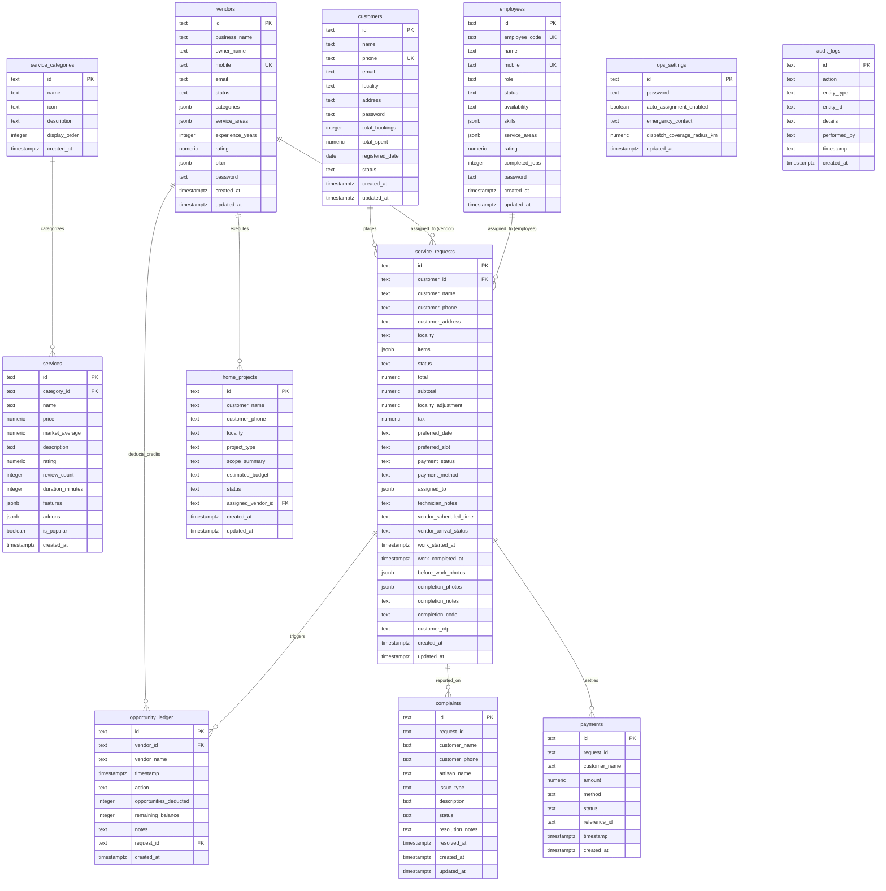
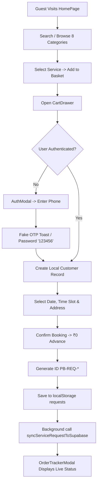
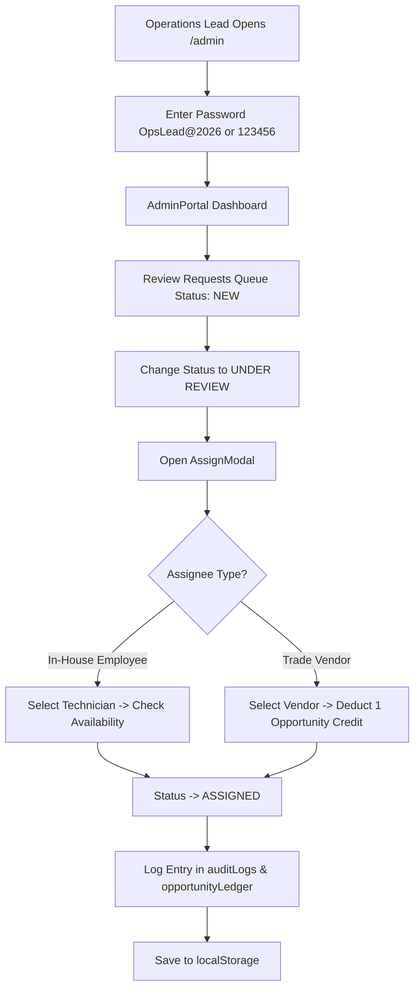
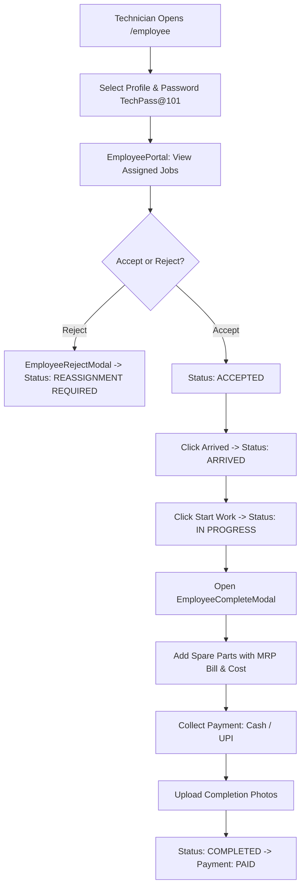
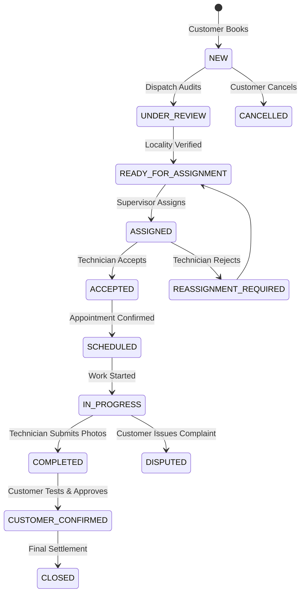

# Comprehensive Architectural & Security Audit Report
**Project:** UrbanCare Solution (PindCare)  
**Target Market:** Sectors 94–111, Mohali & Kharar, Punjab  
**Audit Type:** Read-Only Full-Stack Architecture, Code Quality & Security Assessment  
**Date:** October 2026  
**Auditor:** Senior Full-Stack Architect & Security Auditor  

---

## A. Executive Summary

UrbanCare Solution is currently a client-side Single Page Application (SPA) built with React 19 and Vite, not a production full-stack system.
The codebase lacks a functional backend server or custom API layer; business logic and data persistence operate almost exclusively in browser `localStorage`.
A complete Firebase Firestore implementation exists in the repository but remains completely orphaned and unreferenced by the application components.
Supabase PostgreSQL is partially configured as an alternative backend, but its database Row Level Security (RLS) policies permit unrestricted public read and write access.
Every authentication flow contains hardcoded master backdoors (`123456`) and default fallback passwords, allowing trivial privilege escalation to the Operations Command Portal.
User role authorization is evaluated only in browser React state and `localStorage`, meaning any guest can bypass admin gates by modifying local values.
The pricing engine imposes a hardcoded `₹99` visit fee, directly contradicting user-facing marketing and homepage guarantees of `₹149` (waived on repair).
DPDP Act 2023 compliance features (consent management, data rights, erasure, nominee) are cosmetic front-end forms that do not persist to or erase from a server.
Real API keys (Google Gemini API key in `.env` and Firebase credentials in configuration files) are stored directly in the repository without server mediation.
The application cannot securely support real users or multi-device operations until an authenticated backend server, real SMS OTP, and proper database security are deployed.

---

## B. Tech Stack and Database Architecture

### 1. Technology Stack Breakdown

| Component | Technology | Version | Details & Configuration |
| :--- | :--- | :--- | :--- |
| **Frontend Framework** | React | `19.0.1` | SPA rendering with React DOM `19.0.1` |
| **Language** | TypeScript | `7.0.2` | Strict typing configured in `tsconfig.json` |
| **Build & Dev Server** | Vite | `8.3.0` | Port 3000, `@vitejs/plugin-react` `6.1.1` |
| **Styling** | Tailwind CSS | `4.3.3` | `@tailwindcss/vite` `4.3.3`, `@import "tailwindcss"` in `src/index.css` |
| **Icons & Motion** | Lucide React / Motion | `0.546.0` / `12.23.24` | Iconography and animated transitions |
| **Client State** | React Context API | Native | Single monolithic context (`src/context/AppContext.tsx`, 2,751 lines) |
| **Client Storage** | Web Storage API | Native | `localStorage` keys: `pindcare_*`, `urbancare_*` |
| **Backend Framework** | Express (Unused) | `4.21.2` | Declared in `package.json`, but `server.js` was deleted; 0 active API routes |
| **Hosting Config** | Vercel | N/A | `vercel.json` configuring client-side routing fallback to `/index.html` |

### 2. Database Services & Configurations

The project contains **three divergent data persistence layers**:

1. **Active Runtime Layer (Local Mock Storage):**
   - **Engine:** Browser `window.localStorage`
   - **Data Seed:** Hardcoded arrays in `src/data/initialData.ts` (2,797 lines)
   - **Behavior:** All CRUD operations for services, bookings, staff, vendors, complaints, and audit logs mutate in-memory state and serialize to `localStorage`. Data does not synchronize across devices or users.
2. **Primary Relational Layer (Supabase PostgreSQL):**
   - **Client:** `@supabase/supabase-js` `2.117.3`
   - **Configuration:** `src/lib/supabase.ts` reads `VITE_SUPABASE_URL` and `VITE_SUPABASE_ANON_KEY`. Currently disconnected (`.env` contains empty strings).
   - **Schema & Migrations:** `supabase/schema.sql` (12 relational tables) and `supabase/seed.sql`.
   - **Client Service:** `src/services/supabaseService.ts` contains read/write mappers, but only `syncServiceRequestToSupabase` is actively invoked from `AppContext.tsx`; all other sync functions (`syncCustomer`, `syncPayment`, `syncComplaint`, `syncVendor`, `syncEmployee`) are orphaned imports.
3. **Legacy / Orphaned Layer (Firebase Firestore):**
   - **Client:** `firebase` `13.0.0` (`firebase/firestore`, `firebase/auth`)
   - **Configuration:** Initialized in `src/firebase.ts` reading `firebase-applet-config.json` (Project ID: `opportune-composite-dfjbn`).
   - **Security Rules:** `firestore.rules` (106 lines).
   - **Status:** **Dead Code**. `src/firebase.ts` is not imported or utilized by any component in `src/`.

### 3. Comprehensive Inventory of Hardcoded Data

| Data Category | File Location | Hardcoded Value(s) | Operational Impact |
| :--- | :--- | :--- | :--- |
| **Master Passwords** | `src/context/AppContext.tsx` | `'123456'`, `'OpsLead@2026'`, `'TechPass@101'`, `'MalwaPass@2026'` | Allows universal unauthorized login to any role |
| **Admin Email** | `firestore.rules`, `AppContext.tsx` | `'vilkhu08@gmail.com'`, `'ops@urbancaresolution.in'` | Hardcoded admin identity check |
| **Service Catalog** | `src/data/initialData.ts` | 35+ services across 8 categories with static prices, scopes, FAQs | Rates cannot be dynamically updated without editing code or local storage |
| **Active Requests** | `src/data/initialData.ts` | 9 pre-existing requests (`PB-8828`, `PB-8832`, `PB-8829`, `PB-8835`, `PB-8825`, `PB-8821`, `PB-8819`, `PB-8815`, `PB-8810`, `PB-8830`, `PB-8826`) | Fills customer tracker and admin dashboard with mock customer records |
| **Customer Reviews** | `src/data/initialData.ts` | 3 static reviews (Rajinder Sharma, Simranjeet K., Harinder Singh) | Displayed on Home Page as live customer feedback |
| **Coverage Zones** | `src/data/initialData.ts` | 11 zones (`zone-sec-94` to `zone-sec-111`) | Hardcoded sector descriptions, enclaves, response times, and technician counts |
| **Verified Pro Counts** | `src/data/initialData.ts` | Static numbers (e.g. 8 in Sec 94, 14 in Sec 110, 12 in Sec 111) | Static claims of active on-duty personnel |
| **Technician Records** | `src/data/initialData.ts` | 4 technicians (Gurpreet Singh, Kuldeep Sharma, Vicky Sharma, Harinder Pal) with pre-assigned codes | In-house staff profiles and phone numbers |
| **Vendor Partners** | `src/data/initialData.ts` | 4 contractor businesses (Malwa Cooling, Kharar Hydraulic, ShineMaster, Jatt Fabrication) | Pre-configured trade partner profiles and remaining opportunity quotas |
| **Emergency Contact** | `src/data/initialData.ts`, `supabase/schema.sql` | `+91 98889 00122`, `+91 82840 18909` | Dispatch telephone lines |

### 4. Third-Party Services Audit

- **Authentication:** None. No Supabase Auth, Firebase Auth, Auth0, or Clerk session flow is active. Authentication is purely mocked using phone/password lookups against `localStorage`.
- **Payment Processing:** None. No Razorpay, Cashfree, Stripe, or Paytm SDK is installed. Offline Cash and UPI are manually marked as `PAID` via client forms.
- **SMS & Messaging:** None. No Twilio, MSG91, or Fast2SMS integration. Verification codes are simulated via browser `setTimeout` toasts. WhatsApp links are plain HTML `https://wa.me/` anchors.
- **Email Delivery:** None. No SendGrid, Resend, or AWS SES. Links use `mailto:`.
- **Maps & Geolocation:** None. No Google Maps Platform or Mapbox SDK. Addresses are free-form text strings and static sector dropdowns.
- **File Storage:** Mocked. While Firebase Storage and Supabase Storage clients exist, user photo uploads (damage photos, completion proof) utilize external Unsplash URLs or base64 strings.
- **Artificial Intelligence:** `@google/genai` is installed in `package.json`, and a key variable is defined in `.env`, but 0 imports or AI functions exist in `src/`.
- **Analytics & Tracking:** None. No Google Analytics (GA4), Mixpanel, or PostHog scripts are loaded.

---

## C. ER Diagram & Data Model Notes

### 1. PostgreSQL Relational Entity-Relationship Diagram



### 2. Data Model Analysis & Flaws

1. **Denormalization Overuse:** Core arrays such as order line items (`service_requests.items`), assignment history, photos, vendor quotas (`vendors.plan`), and trade categories are stored as unstructured `JSONB` columns rather than normalized join tables (`order_items`, `vendor_skills`). This impedes indexing and aggregate reporting.
2. **Missing Referential Integrity:**
   - `complaints.request_id` is a bare `TEXT` column without a foreign key constraint pointing to `service_requests.id`.
   - `payments.request_id` lacks an FK constraint, allowing orphaned payments if a booking is purged.
3. **Plaintext Password Storage:** Four distinct tables (`ops_settings`, `customers`, `employees`, `vendors`) maintain explicit `password TEXT` columns storing unhashed credentials.
4. **Primary Key Typing:** All primary keys use `TEXT` rather than native `UUID` or `BIGSERIAL`. While flexible for formatted codes (`PB-8828`, `emp-1`), string indexing degrades join performance at scale.

---

## D. Role & Permission Matrix

### 1. Code Roles vs Reality

| Role Identifier | Intended Responsibility | Code Implementation Reality | Major Security Gap |
| :--- | :--- | :--- | :--- |
| **`guest`** | Browse public catalog, check sector coverage, request quotes | Full read access to public views, can view local tracking if request ID is known | Can trigger booking creation without phone verification |
| **`customer`** | Place orders, track active bookings, pay on completion, manage privacy | Authenticated via local state; details saved in `localStorage`; can cancel or review bookings | Account takeover possible with any phone number and password `'123456'` |
| **`employee`** | View assigned jobs, update arrival, upload parts & completion photos, collect payment | Accesses `/employee`; views jobs where `assignedTo.id == currentEmployeeId`; can complete jobs | Login gate pre-fills password; can switch technician ID via dropdown |
| **`vendor`** | Manage trade leads, accept/reject assignments, schedule visits, view ledger | Accesses `/vendor`; views assigned jobs & cluster leads; balance deducted on assignment | Login gate pre-fills password; vendor verification check is only client-side |
| **`operations`** | Central dispatch, manual/auto assignment, pricing edits, payments, complaints | Accesses `/admin`; unrestricted access to dispatch, user accounts, and database configuration | Complete admin control accessible via password `'OpsLead@2026'` or `'123456'` |

### 2. Action Permission Matrix

| Capability / Action | Guest | Customer (Resident) | Employee (Technician) | Vendor (Partner) | Operations (Admin) | Enforced By |
| :--- | :---: | :---: | :---: | :---: | :---: | :--- |
| **View Service Catalog** | Allowed | Allowed | Allowed | Allowed | Allowed | Public Component |
| **Create Booking** | Allowed | Allowed | Denied | Denied | Allowed | `CartDrawer.tsx` |
| **Track Specific Order** | Denied (UI hidden) | Own Orders | Assigned Only | Assigned Only | All Orders | Client Filter |
| **Access `/admin` Dashboard** | Denied (Gated) | Denied (Gated) | Denied (Gated) | Denied (Gated) | Allowed | `App.tsx` (Client Check) |
| **Access `/vendor` Portal** | Denied (Gated) | Denied (Gated) | Denied (Gated) | Allowed | Allowed | `App.tsx` (Client Check) |
| **Access `/employee` Portal** | Denied (Gated) | Denied (Gated) | Allowed | Denied (Gated) | Allowed | `App.tsx` (Client Check) |
| **Assign / Reassign Tech** | Denied | Denied | Denied | Denied | Allowed | `AssignModal.tsx` |
| **Accept / Reject Job** | Denied | Denied | Allowed | Allowed | Allowed | Portal Modals |
| **Complete Work & Add Parts** | Denied | Denied | Allowed | Allowed | Allowed | Complete Modals |
| **Edit Catalog Pricing** | Denied | Denied | Denied | Denied | Allowed | `EditPricingModal.tsx` |
| **Record Offline Payment** | Denied | Denied | Allowed (Job) | Allowed (Job) | Allowed (Global) | `RecordPaymentModal.tsx`|
| **Resolve Complaints** | Denied | Denied | Denied | Denied | Allowed | `ComplaintResolveModal` |
| **Trigger Data Erasure** | Denied | Own (Client only)| Denied | Denied | Denied | `DPDPDataRightsModal` |

*Security Note:* Because all role gates are evaluated on the client inside `App.tsx`, altering `localStorage.getItem('pindcare_current_role_v1')` instantly grants access to any page.

---

## E. User Flow Diagrams per Role

### 1. Guest & Customer Booking Flow
**Status:** **Working in Local UI / Missing Real Backend**


- **What works end-to-end:** Service selection, pricing calculation, cart accumulation, and local order creation.
- **What is a dead end:** Booking confirmation does not notify an operations phone, dispatch an SMS to the resident, or verify credit cards.
- **What is missing:** Real SMS gateway verification, address geocoding, server-side idempotency.

---

### 2. Operations Dispatch Workflow
**Status:** **Working in Local UI / Unsecured**


- **What works end-to-end:** Visual assignment, technician skill filtering, quota deduction in local ledger, and audit log appending.
- **What is a dead end:** Deductions do not notify vendors via push notification; changes remain isolated to the dispatcher's browser unless Supabase happens to be online.
- **What is missing:** Multi-dispatcher concurrency handling, real-time push dispatch alerts.

---

### 3. Field Technician Job Lifecycle
**Status:** **Working in Local UI / Mocked Execution**


- **What works end-to-end:** Step-by-step state machine transition, spare part calculation, completion summary modal.
- **What is a dead end:** Photo upload uses mock image pickers; customer signature/OTP (`customer_otp`) is not cryptographically validated.
- **What is missing:** Real GPS geofence arrival verification, payment gateway UPI intent generation, physical camera hardware integration.

---

### 4. Booking Status Lifecycle Enforcement

The code defines 15 discrete statuses in `src/types/index.ts`:



*Code Enforcement:* Status changes are managed via `updateRequestStatus` in `src/context/AppContext.tsx` (lines 1618–1682). Crucially, **transitions are not strictly validated by an invariant state machine**. A user or admin can force jump an order directly from `NEW` to `COMPLETED` or `CLOSED` without following intermediate requirements.

---

## F. Findings List (Vulnerabilities, Quality & Operational Risks)

### 1. Critical Severity Findings

#### Finding SEC-01: Universal Hardcoded Backdoor Credentials
- **Severity:** `CRITICAL`
- **File Paths:**
  - `src/context/AppContext.tsx` (lines 798, 825, 861, 890, 1039, 1083, 1101)
  - `src/components/customer/AuthModal.tsx` (line 130)
- **Vulnerability Description:** The authentication validation routines explicitly check:
  `if (otpOrPassword !== expectedPassword && otpOrPassword !== '123456')`
  This backdoor exists identically across Customer, Technician, Vendor, and Operations Admin logins.
- **Impact:** Any individual with knowledge of a phone number or employee code can gain full authenticated access to that user's account by typing `123456`. An attacker can access the full Operations Command Portal (`/admin`) using any known admin email and `123456`.
- **Suggested Fix:** Permanently remove all `'123456'` and hardcoded password bypasses. Migrate authentication to a server-side identity provider (e.g., Supabase Auth or an Express authentication service) that verifies bcrypt/argon2 password hashes or one-time cryptographic tokens.

#### Finding SEC-02: Exposed Production API Secret in Repository Root
- **Severity:** `CRITICAL`
- **File Path:** `.env` (line 4, variable `GEMINI_API_KEY`)
- **Vulnerability Description:** An active Google Gemini API key (`AIzaSy...`) is committed directly into the `.env` file within the local repository.
- **Impact:** Compromise of this secret enables unauthorized third parties to consume Google Cloud AI Studio API quotas, generate unexpected financial bills, or abuse the API quota to cause denial-of-service for the legitimate application.
- **Suggested Fix:**
  1. Revoke the exposed API key immediately in the Google Cloud / AI Studio console.
  2. Regenerate a new API key.
  3. Ensure `.env` is listed in `.gitignore` and never committed to source control.
  4. Proxy all generative AI calls through a secure backend service rather than invoking them from client bundles.

#### Finding SEC-03: Completely Insecure Supabase Row Level Security (RLS) Policies
- **Severity:** `CRITICAL`
- **File Path:** `supabase/schema.sql` (lines 300–338)
- **Vulnerability Description:** While RLS is enabled on all 12 tables, the policies grant universal read and write access to the unauthenticated public:
  ```sql
  CREATE POLICY "Allow public read customers" ON customers FOR SELECT USING (true);
  CREATE POLICY "Allow update customers" ON customers FOR UPDATE USING (true);
  CREATE POLICY "Allow read employees" ON employees FOR SELECT USING (true);
  CREATE POLICY "Allow read ops settings" ON ops_settings FOR SELECT USING (true);
  ```
- **Impact:** Anyone possessing the public `anon` key (which is distributed in client JavaScript bundles) can query `SELECT * FROM customers`, `SELECT * FROM employees`, and `SELECT * FROM ops_settings`, dumping all user names, personal phone numbers, physical residential addresses, and plaintext passwords. Attackers can also execute mass deletions or updates.
- **Suggested Fix:** Rewrite all RLS policies to evaluate authenticated identity (`auth.uid()`). Prevent public access to `customers`, `employees`, `vendors`, `payments`, `complaints`, and `ops_settings`. Public access should be restricted strictly to `service_categories` and `services`.

#### Finding SEC-04: Firestore Security Rules Permit Public Document Harvesting
- **Severity:** `CRITICAL`
- **File Path:** `firestore.rules` (lines 70, 81, 90, 99)
- **Vulnerability Description:** The Firestore security rules grant unauthenticated listing permissions:
  ```javascript
  match /service_requests/{requestId} {
    allow list: if true;
    ...
  }
  ```
- **Impact:** Any anonymous user can issue a collection query against the Firestore endpoint to download all residential service bookings, including full names, phone numbers, home addresses, problem notes, and billing totals.
- **Suggested Fix:** Replace `allow list: if true;` with strict authentication checks ensuring users can only query documents matching their `request.auth.uid`.

#### Finding SEC-05: Pure Client-Side Role Authorization Gating
- **Severity:** `CRITICAL`
- **File Paths:**
  - `src/App.tsx` (lines 56, 85, 114)
  - `src/context/AppContext.tsx` (lines 330–337)
- **Vulnerability Description:** Administrative portals (`/admin`, `/vendor`, `/employee`) are protected solely by checking React state variable `currentRole`, which is initialized directly from `localStorage.getItem('pindcare_current_role_v1')`.
- **Impact:** Any user can open their browser developer console, execute `localStorage.setItem('pindcare_current_role_v1', 'operations')`, and refresh the page to gain unfettered administrative access to the Operations Command Portal.
- **Suggested Fix:** Route authorization must be validated by an authenticated server session. Administrative components must not be rendered or dispatched without a verified JWT containing signed role claims (`role === 'operations'`).

---

### 2. High Severity Findings

#### Finding SEC-06: Plaintext Password Storage Across Schemas & Data Structures
- **Severity:** `HIGH`
- **File Paths:**
  - `supabase/schema.sql` (lines 27, 42, 67, 97)
  - `src/services/supabaseService.ts` (lines 36, 50, 72, 87)
  - `src/data/initialData.ts` (lines 1700, etc.)
- **Vulnerability Description:** Passwords for operations supervisors (`OpsLead@2026`), technicians (`TechPass@101`), vendors (`MalwaPass@2026`), and customers (`Resident@123`) are stored in plaintext in database columns and client data files.
- **Impact:** Clear violation of DPDP Act 2023 and information security standards. Any database breach immediately exposes every credential in plaintext.
- **Suggested Fix:** Remove password columns from application tables. Delegate password management to an industry-standard authentication service (e.g., Supabase Auth / Argon2id).

#### Finding ARCH-01: Non-Existent Backend Architecture (Orphaned Express Dependency)
- **Severity:** `HIGH`
- **File Paths:** `package.json` (line 19), repository structure
- **Vulnerability Description:** The project includes `express` in `package.json`, but contains no server scripts or API endpoints. All business logic executes directly in the browser client.
- **Impact:** Business operations (pricing, voucher discounts, order assignments, fee calculations, payment logging) can be trivially tampered with by modifying client JavaScript memory.
- **Suggested Fix:** Deploy a real server application (Node.js/Express, Next.js API routes, or Supabase Edge Functions) to handle checkout calculations, order status transitions, and administrative assignments.

#### Finding SEC-07: Simulated, Insecure Phone OTP Verification
- **Severity:** `HIGH`
- **File Path:** `src/components/customer/AuthModal.tsx` (lines 110–148)
- **Vulnerability Description:** The OTP verification flow simulates message dispatch using a 400ms `setTimeout`, emits a visual toast, and permits any entered number or the default `'123456'` to authenticate.
- **Impact:** No phone ownership verification actually occurs. An attacker can register or log into any citizen's mobile number simply by entering the 10-digit number.
- **Suggested Fix:** Integrate an enterprise SMS gateway (e.g., MSG91, Twilio) that generates, transmits, and validates server-side cryptographically random, 6-digit OTPs expiring within 5 minutes.

#### Finding SEC-08: Pre-Filled Credentials in Portal Login Forms
- **Severity:** `HIGH`
- **File Paths:**
  - `src/pages/employee/EmployeePortal.tsx` (line 69)
  - `src/pages/vendor/VendorPortal.tsx` (line 89)
  - `src/components/customer/AuthModal.tsx` (lines 69, 76, 79, 82)
- **Vulnerability Description:** The login input components initialize password state directly with the active default passwords (e.g., `useState('TechPass@101')`, `useState('MalwaPass@2026')`, `useState('OpsLead@2026')`).
- **Impact:** Any user browsing to `/employee` or selecting "Staff & Partner Login" in the modal finds the password input already populated and needs only to click "Login" to enter.
- **Suggested Fix:** Initialize all password input states with empty strings (`''`) and remove all auto-fill logic.

---

### 3. Medium Severity Findings

#### Finding BUS-01: Pricing Engine Inconsistency Between Calculation & Marketing
- **Severity:** `MEDIUM`
- **File Paths:**
  - `src/utils/pricingEngine.ts` (lines 42, 207)
  - `src/pages/HomePage.tsx` (lines 28, 477)
- **Vulnerability Description:** The central pricing engine enforces a hardcoded `₹99` visit fee (`visit_fee ?? 99` and `hasStandardService ? 99 : 0`). However, homepage copy, hero text, and FAQs explicitly state that the inspection fee is `₹149` (waived on repair).
- **Impact:** When a user books a service, the cart breakdown calculates `₹99` instead of `₹149`, creating confusion and accounting discrepancies between customer receipts and advertised policies.
- **Suggested Fix:** Create a unified pricing configuration object and import it directly into `pricingEngine.ts`, ensuring calculation rules and marketing displays remain synchronized.

#### Finding PRIV-01: Client-Only DPDP Act 2023 Implementation
- **Severity:** `MEDIUM`
- **File Paths:**
  - `src/components/dpdp/DPDPDataRightsModal.tsx`
  - `src/context/AppContext.tsx` (lines 278–293)
- **Vulnerability Description:** Data rights, consent preferences, nominee nominations, and data erasure requests exist solely in browser `localStorage`.
- **Impact:** If a user exercises their legal Right to Erasure, only their local browser storage is cleared; records existing in Supabase or backend tables remain untouched. Furthermore, clearing browser cache deletes consent logs, violating statutory consent audit trails.
- **Suggested Fix:** Connect DPDP consent logging, grievance ticket creation, and erasure workflows to an immutable server database table with real Data Protection Officer (DPO) ticketing notifications.

#### Finding ARCH-02: Orphaned Firebase Architecture & Redundant Dependencies
- **Severity:** `MEDIUM`
- **File Paths:** `src/firebase.ts`, `firebase-applet-config.json`, `firebase-blueprint.json`
- **Vulnerability Description:** The application includes Firebase SDKs, configuration files, and helper methods, none of which are utilized in the runtime application.
- **Impact:** Increases production bundle payload and exposes unnecessary third-party configuration metadata.
- **Suggested Fix:** Fully remove the Firebase dependency and associated configuration files if Supabase PostgreSQL is the chosen production datastore.

---

### 4. Low Severity Findings

#### Finding QUAL-01: Complete Absence of Automated Test Suites
- **Severity:** `LOW`
- **File Path:** `package.json`
- **Vulnerability Description:** The project contains 0 unit tests, 0 integration tests, and no test framework (Vitest, Jest, Playwright).
- **Impact:** High probability of breaking pricing calculations, role permissions, or booking flows during future code modifications.
- **Suggested Fix:** Configure Vitest and React Testing Library; write regression tests for the pricing engine, booking flow, and role protection logic.

#### Finding QUAL-02: Missing Production Error Boundaries
- **Severity:** `LOW`
- **File Path:** `src/App.tsx`
- **Vulnerability Description:** The root application does not implement React Error Boundaries.
- **Impact:** An uncaught rendering error in any sub-component or corrupted `localStorage` record will crash the entire page into a blank white screen.
- **Suggested Fix:** Wrap `<AppContent />` in a robust React Error Boundary component with a friendly recovery prompt.

---

## G. Prioritized Action Plan

### Phase 1: This Week (Critical Security & Credentials Lockdown)
1. **Revoke Exposed Keys:** Immediately revoke the exposed Google Gemini API key in Google Cloud Console. Rotate and place it into a secure environment file excluded from git.
2. **Eliminate Backdoors:** Remove `'123456'` and hardcoded password bypasses from `src/context/AppContext.tsx` and `src/components/customer/AuthModal.tsx`.
3. **Clear Auto-Populated Passwords:** Remove pre-filled passwords (`TechPass@101`, `MalwaPass@2026`, `OpsLead@2026`) from `EmployeePortal.tsx`, `VendorPortal.tsx`, and `AuthModal.tsx`.
4. **Lock Down Supabase RLS:** Replace the open `USING (true)` policies in `supabase/schema.sql` with authenticated owner checks.
5. **Harmonize Visit Fee:** Align the visit fee across `pricingEngine.ts` and `HomePage.tsx` to eliminate discrepancies between cart calculations and promotional copy.

### Phase 2: This Month (Architecture & Core Reliability)
1. **Deploy a Secure Backend API:** Implement a Node.js/Express service or Supabase Edge Functions to handle checkout calculations, order persistence, and role verification.
2. **Implement Real SMS Authentication:** Replace simulated OTPs with a production SMS gateway (e.g., MSG91/Twilio) utilizing short-lived, rate-limited tokens.
3. **Transition to Server Authentication:** Migrate user, technician, vendor, and admin authentication to Supabase Auth with secure JWT cookies.
4. **Prune Dead Code:** Delete `src/firebase.ts`, `firebase-applet-config.json`, and `firestore.rules`. Remove `@google/genai` if AI features are not actively planned.
5. **Implement Real Payment Processing:** Integrate a licensed payment gateway (e.g., Razorpay/Cashfree) with server-side webhook signature verification.

### Phase 3: Later (Scale & Compliance Hardening)
1. **Server-Side DPDP Compliance:** Connect consent logging, grievance tickets, and data erasure requests to a secure database audit journal.
2. **Automated Testing Suite:** Establish Vitest unit tests for pricing calculations and Playwright E2E tests for core booking flows.
3. **Application Monitoring & Error Handling:** Implement React Error Boundaries and integrate Sentry for frontend error tracking.
4. **Performance & Concurrency:** Normalize `JSONB` database columns into indexed relational tables to support 100+ concurrent daily dispatches.

---

## H. Questions for Stakeholders & Clarifications Needed

1. **Primary Datastore Selection:** Should the production architecture standardize on Supabase PostgreSQL or Google Firebase Firestore? (Currently both exist, causing conflict).
2. **Official Inspection Fee Policy:** What is the definitive commercial pricing rule for diagnostics: `₹99` (as calculated by the pricing engine) or `₹149` (as stated in marketing)?
3. **SMS & WhatsApp Vendor Selection:** Which licensed gateway provider (Twilio, MSG91, Gupshup, Fast2SMS) will be contracted for OTP dispatch and WhatsApp messaging?
4. **Payment Gateway Choice:** Which payment aggregator (Razorpay, Cashfree, Paytm) will be utilized for doorstep UPI dynamic QR and card collections?
5. **Staff Onboarding Model:** Are field technicians and trade contractors intended to be self-registering with automated verification, or will all staff be manually provisioned by Operations supervisors?
6. **AI Roadmap:** Is Google Gemini AI planned for automated dispatch optimization or customer support chatbots, or should the `@google/genai` library be removed to reduce attack surface?
